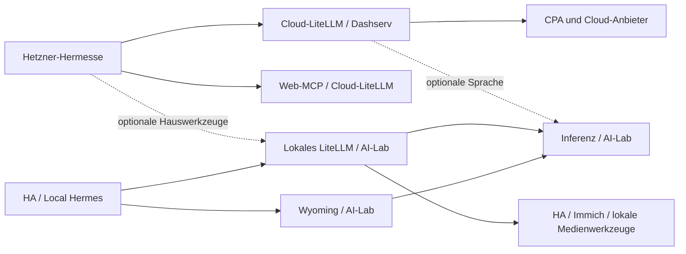

# Dienste zwischen Homelab und VPS aufteilen

Stand: 2026-09-29. **Plan, nicht implementiert.** Grundlage sind die lesenden
Prüfungen vom 26./27. September, die DNS-Nachprüfung vom 29. September und der
bereits anderweitig veränderte Worktree. Kapazitäten, Versionen und Endpunkte vor
Umsetzung erneut prüfen.

## 1. Ziel und Grenzen

- Haussteuerung und lokale KI funktionieren ohne Heim-Internet weiter.
- Die Hetzner-Hermesse können dann weiterhin Textchat und Web-Werkzeuge nutzen.
- Sprache und Hauswerkzeuge der Cloud-Hermesse dürfen bei Heim-WAN-Ausfall
  vorübergehend fehlen. Zunächst kein zusätzlicher Cloud-Sprachanbieter.
- Zwei LiteLLM-Instanzen mit eigenen Datenbanken; zwei Kuma-Instanzen mit
  verschiedenen Aufgaben. Keine laufende Datenbank-Synchronisierung.
- Bestehende Berechtigungen, Benutzerdaten, OAuth-Verbindungen und Sprach-APIs
  erhalten. Native Konfiguration und Ansible verwenden, keine Upstream-Patches.
- Alle Hermes-Instanzen bleiben im Basisplan auf ihren bisherigen Hosts und
  Datenpfaden. Geändert werden ihre Gateway-/MCP-Verbindungen. Docker-Hermesse
  später nach Dashserv zu verschieben ist eine Option, kein beschlossener Umzug.
  Keine Modell-, GPU- oder Versionsumstellung beim Umzug der anderen Dienste.

**Hermes Assist wurde entfernt.** Container, Netzwerk, Service-Eintrag,
DNS-/Caddy-Route und beide AutoKuma-Monitore sind zurückgebaut; siehe
[Rückbau und verifizierter Stand](hermes-assist-retirement.md).
Nicht migrieren, neu anlegen oder als Voraussetzung einplanen.
Die normale HA-Pipeline „Local Hermes“ ist davon unabhängig und bleibt erhalten.

**Native Android-App:** Sie ersetzt für Daniel die experimentelle Sprachoberfläche.
Ihr Repository und ihre tatsächlichen Endpunkte wurden noch nicht untersucht.
Vor dem Umschalten Chat-/Hermes-API, STT, TTS, WebSocket, Schlüssel, Login und
Verhalten in WLAN/Mobilfunk aufnehmen. Nicht unterstellen, dass sie dieselben
Pfade wie Hermes Assist verwendet oder bereits einen lokalen Modus besitzt.

## 2. Zielverteilung

| Standort | Dienste |
| --- | --- |
| NUC | HA, MQTT, Zigbee/Matter, EVCC, Pi-hole/DHCP, lokaler Caddy, Pocket ID, HA-MCP, lokales Kuma/AutoKuma; Medien, Downloads, Immich, Speicher und Backups |
| AI-Lab | Lokales LiteLLM + PostgreSQL/Redis, Local Hermes, LLM/STT/TTS/Embeddings, Wyoming, Open WebUI, Phoenix; bestehende GPU- und Entwicklungsdienste |
| Dashserv | Cloud-LiteLLM + PostgreSQL/Redis, CPA + Usage Keeper, Web-MCPs; anschließend Google Workspace MCP, ChangeDetection und n8n |
| Hetzner | Bestehende Bare-Metal-/Docker-Hermesse; externes Kuma nach Speicherbereinigung |
| Nameserver / Backup-NAS | Bestehende Aufgaben, keine zusätzlichen Anwendungsstacks |

TeslaMate samt PostgreSQL/Grafana ist ein späterer Kandidat. Sein MQTT-Broker
liegt auf dem NUC; Aufzeichnung und Neustart ohne erreichbaren Broker zunächst
testen. Linkding/Readeck, Beszel, Dozzle und Dockhand bleiben vorerst unverändert.
Internetbedarf allein rechtfertigt keinen Umzug der lokalen Medienkette.

## 3. Abhängigkeiten und Ausfallverhalten

Aktuell gehen selbst Cloud-Textchat und Web-MCP der Hetzner-Hermesse über den NUC.
Auf Hetzner lösen `litellm.kirelabs.org` und `id.kirelabs.org` zur LAN-Adresse des
NUC auf. Das aktuelle LiteLLM-Compose koppelt den Start außerdem an `ha-mcp`.
Kuma sendet an Hetzner-Hermes, dessen Modellzugriff wiederum am NUC hängt.

Die Zielpfade sind:



| Heim-WAN fehlt | Erwartung nach Migration |
| --- | --- |
| Cloud-Textchat, Delegation, Cloud-Bildgenerierung, Web-MCP | Weiter verfügbar; kein Heim-DNS, Heim-Proxy oder Heim-DB im Pflichtpfad |
| Cloud-Sprachnachricht | Transkription nicht verfügbar; verständlicher Fehler und Textbedienung möglich |
| Cloud-Sprachausgabe | Sprache nicht verfügbar; Textantwort bleibt nutzbar |
| Cloud-Zugriff auf Haus/GPU/Dateien | Betroffene Funktion fehlt, Textchat bleibt benutzbar |
| HA / Local Hermes im LAN | Lokales Modell, Sprache und Hauswerkzeuge funktionieren |
| Cloud-SSO mit Pocket ID | Neue Anmeldung/Erneuerung kann ausfallen; keine Zusage für bestehende Browser-Sitzungen |
| Cloud-Traces an lokales Phoenix | Dürfen fehlen, Modellantwort darf nicht blockieren |
| Android-App | Cloud-Textmodus nach App-Prüfung; Sprache abhängig von den tatsächlich verwendeten Endpunkten |

### Modelle und Sprache

- Bestehende Domain `litellm.kirelabs.org` wird das Cloud-Gateway. Neues lokales
  Gateway: `litellm-local.kirelabs.org`. Kein unterschiedlicher Datenbank-Backend
  unter demselben Namen je nach Clientstandort.
- Beide Gateways bieten dieselben lokalen Sprach-Aliase an. Cloud leitet Sprache
  direkt über das private Netz an AI-Lab weiter; kein zusätzlicher Gateway-Hop.
- Erhalten: `home-asr`, `home-asr-stream`, `home-tts`, `home-tts-design`,
  `/v1/audio/transcriptions`, `/v1/realtime`, `/v1/audio/speech`,
  `/v1/audio/speech/stream` und `/v1/audio/voices` einschließlich Audioformaten,
  WebSocket-Verhalten und separater Passthrough-Berechtigungen.
- Lokales Gateway enthält lokale Modelle; Cloud-Gateway enthält Cloud-Modelle
  und die ausdrücklich benötigten lokalen Angebote. Vorhandene externe Nutzer
  lokaler Chat-/Embedding-Modelle erfassen und erhalten, nicht still entfernen.
- Local Hermes bleibt standardmäßig auf `home-hermes`, ohne automatischen
  Cloud-Fallback. Manuelle Cloud-Modellwahl erfolgt über ein zusätzliches
  Hermes-Providerprofil zum Cloud-Gateway. Open WebUI kann beide APIs anbinden.
  Keine wechselseitige Gateway-Weiterleitung sämtlicher Modellkataloge.
- Lokale Hilfsaufrufe wie Kompression, Vision und Delegation ebenfalls prüfen;
  ein lokales Hauptmodell allein beweist keine Offline-Fähigkeit.
- Aktuelle STT-Defaults im Bare-Metal-Hermes: 60 Sekunden und ein Retry. Fehler-
  und Verbindungswartezeit begrenzen, ohne legitime Modellstarts abzuschneiden.
  Kein automatischer Replay fehlgeschlagener Agenten-/Werkzeugaktionen.

## 4. MCP: Ausführungsort von Berechtigungen trennen

Ein Katalog bleibt die Quelle. Jeder Server erhält einen Ausführungsort. Gruppen
wie `home_control` bleiben Berechtigungen und werden nicht zu Standortgruppen.

| MCP-Eintrag | Gateway | Begründung / Besonderheit |
| --- | --- | --- |
| `hamcp` | lokal | Spricht mit HA; vorhandenen HA-MCP-Dienst auf NUC erhalten, Adresse vom Docker-Namen `ha-mcp` auf privaten erreichbaren Endpunkt umstellen |
| `home_assistant` | lokal | Native HA-MCP-Schnittstelle; `home_control` bleibt getrennt von `home_admin` |
| `immich` | lokal | Lokale Fotos/API; stdio-Prozess im lokalen LiteLLM-Image |
| `comfyui`, `wangp` | lokal | GPU und lokale Dateien; Wan2GP-Dateitransport des Bare-Metal-Hermes erhalten |
| `fetch`, `tavily` | Cloud | Webzugriff; prüfen, ob Nutzer bisher bewusst LAN-URLs per Fetch abrufen |
| `todoist`, `github`, `google_maps`, `notion` | Cloud | Externe APIs; bisherige Gruppen und Tool-Allowlists erhalten |
| `regfish`, `craft`, `craft_family` | Cloud | Externe APIs/OAuth; Server-IDs, Benutzerbindung und Refresh-Zustand erhalten |
| `diyfpv` | Cloud | Externe API; bleibt Mitglied aller bisherigen Capability-Gruppen, auch wenn deren Name auf Haus/GPU verweist |
| `n8n` | Cloud | Verwaltungswerkzeug für n8n; zunächst Zugriff auf alte NUC-Instanz, später Dashserv; vor App-Umzug noch heimabhängig |
| Google Workspace MCP | Dashserv, separat wie bisher | Bereits eigener HTTP-Dienst für direkte Clients; kein zusätzlicher Gateway-Umbau aus Anlass des Umzugs |

Persönliche direkte MCP-Einträge wie Craft/ClickUp in Hermes bleiben unangetastet.
Nicht als Teil dieser Migration zwangsweise zentralisieren oder doppelt laden.
`media_generation` bleibt nur beim berechtigten Bare-Metal-Hermes; die Aufteilung
ist kein Anlass, anderen Agenten Zugriff zu geben.

### Clients und Discovery

- Cloud-Hermes behält den bestehenden MCP-Verbindungsnamen `litellm` für Web-MCP
  und erhält bei bestehenden Hausrechten `litellm_home` zum lokalen Gateway.
- Local Hermes behält `litellm` für lokale Werkzeuge und bekommt für seine
  vorhandenen Webrechte `litellm_web` zur Cloud. Kein Webzugriff im lokalen
  Start-/Bereitschaftspfad erforderlich.
- Je Verbindung eigener standortgebundener Schlüssel. Gateway-Authentifizierung
  weiter über `x-litellm-api-key`; OAuth-Header bleiben davon getrennt.
- Kurzer, getesteter Discovery-Verbindungstimeout für die optionale Gegenseite;
  Aufrufzeit getrennt behandeln, etwa für langsame Medienerzeugung. Vorhandene
  native Optionen verwenden, keine selbst entwickelte Wiederholungslogik.
- Kein Gateway ruft das andere als aggregierten MCP-Server auf. Dadurch können
  Haus-Discovery und Web-Discovery unabhängig fehlschlagen.
- Client mit nur einer MCP-Verbindung ist ein expliziter Kompatibilitätsfall:
  vor Umschaltung identifizieren; nicht heimlich alle lokalen Werkzeuge wieder
  in den Cloud-Startpfad ziehen. Android nur prüfen, falls die App selbst MCP nutzt.
- Verbindungsnamen beeinflussen Werkzeugnamen. Wechsel nur zwischen Agenten-
  Läufen, alte History nicht umschreiben. Neustart/neue Sitzung gezielt testen,
  damit keine alten Tool-Calls auf verschwundene Namen zeigen.

### Rechte und Schlüssel

Cloud übernimmt die bestehende LiteLLM-Datenbank, damit bestehende Schlüssel,
Benutzer, Teams, MCP-IDs und OAuth-Zustand nicht neu aufgebaut werden müssen.
Lokal entsteht eine frische DB mit den benötigten deklarativen Berechtigungen.
Kein Klonen sämtlicher Cloud-Zugänge/OAuth-Tokens in die lokale Instanz.

Pro Client werden die vorhandenen Rechte auf beide Kataloge verteilt:

1. Gemeinsame Identität und vorhandene Rechte bleiben deklarative Quelle.
2. Schlüssel je Standort separat in Vault; unterschiedliche Master-/DB-Schlüssel.
3. Serverauswahl, `mcp_access_groups`, direkte Server-IDs und Team-Einschränkungen
   gemeinsam prüfen. Gruppen nicht nur anhand ihres Namens auseinanderteilen;
   Beispiel DIYFPV. Tool-Allowlists auf beiden relevanten Ebenen erhalten.
4. Modellrechte separat projizieren. `all-team-models` nur zusammen mit einer
   geprüften Team-Modellliste verwenden. Leere Listen sind kein verlässliches
   „deny all“; reine MCP-Zugänge durch tatsächliche Negativtests absichern.
5. Bestehende Cloud-Schlüssel zunächst erhalten; lokale neue Schlüssel gezielt
   an HA, Local Hermes, Cloud-Hermes-Hauszugriff und ggf. Android verteilen.
6. Keine generische Gateway-Weiterleitung mit einem gemeinsamen Vollzugriffsschlüssel.
   Pro Kunde bleiben Tool-Zugriff, Widerruf und Modellabrechnung zuordenbar.

## 5. Ansible-Struktur

### Ein MCP-Katalog, zwei Projektionen

`litellm_mcp_servers` bleibt in `roles/llm_tools/defaults/main.yml`. Beispiel für
geplante Metadaten, nicht für direkt an LiteLLM weitergereichte Konfiguration:

```yaml
litellm_mcp_servers:
  hamcp:
    site: local
    url: "{{ ha_mcp_url }}"
    access_groups: [home_admin]
  todoist:
    site: cloud
    # Bestehende URL/Auth/Toolrechte bleiben erhalten.
    access_groups: [shopping]
```

- `litellm_site: local|cloud` wird nur beim jeweiligen Gateway-Host gesetzt.
- Die Rolle berechnet einmal `litellm_mcp_servers_selected` mit dem Gleichheitsfilter `site == litellm_site`.
- LiteLLM-YAML, npm/uv-Preinstall, stdio-Allowlist und benötigte Server-Umgebungen
  verwenden ausschließlich diese Auswahl. `site` und `install` vor Übergabe
  an LiteLLM entfernen. Ausgeschlossene Secrets nicht unnötig auswerten/rendern.
- Fehlender/unbekannter Standort und unbekannte Serverreferenzen sind Fehler.
  Kein stilles „alle Server“, kein Rückschluss aus `access_groups`.
- Keine vollständigen Katalogkopien in `dashserv.yml` und `ailab_ubuntus.yml`.

### Variablen und Zuständigkeiten

| Datei / Rolle | Geplante Aufgabe |
| --- | --- |
| `group_vars/all/services.yml` | Weiterhin Service-Katalog; Backend (`target`) und zuständigen Caddy-Host (`proxy_host`) unterscheiden; Gateway-Endpunkte aus `services.litellm` und `services['litellm-local']` ableiten |
| `group_vars/all/llms.yml` | Inferenzmodelle bleiben hier; lokale und Cloud-Providerlisten sauber benennen; CPA-Upstream statt fester NUC-IP aus Cloud-Endpunkt ableiten |
| `group_vars/all/hermes_mcp.yml` | Gemeinsame Client-/Team-/Toolrechte und Profile; bestehende Docker-Grants einmal hier zusammenführen |
| `group_vars/ailab_ubuntus.yml`, `group_vars/dashserv.yml` | Standort auswählen, Hostpfade/Ports; keine kopierten Rechtekataloge |
| `group_vars/hetzner.yml` | Hermes-Laufzeit und externes Monitoring; keine eigene zweite Schlüsselverwaltung |
| `roles/llm_tools` | Gateway, DB/Redis, ausgewählter MCP-Katalog; vorhandenen Key/Team-Reconciler pro Gateway verwenden |
| `roles/hermes_docker` | Endpunkte/Schlüssel konsumieren; Key-Provisionierung an `llm_tools` abgeben, danach nur einen Schreiber pro Key/Team haben |
| `roles/hermes_baremetal` | Runtime-Envelope; nur gezielte manuelle Hermes-CLI-Anpassungen an Provider/MCP, kein vollständiges Config-Template |
| `roles/monitoring` | Kuma/AutoKuma nach Standort auswählen; Docker-Hosts/Monitore/Benachrichtigungen entsprechend filtern; Dockhand nur lokal |

Die heutige `llm_tools`-Compose enthält auch HA-MCP, Open WebUI und Google
Workspace. Diese drei bestehenden Dienste in kleine eigene Deployment-Rollen
auslagern, weil sie unabhängig vom Gateway den Host wechseln bzw. auf NUC bleiben.
Keine neue Rolle je stdio-MCP. Gemeinsame Compose-Netze sind nach der Trennung
kein impliziter Transport mehr; private URLs und gezielte Firewall-Freigaben nutzen.

Globale Ansible-Variablen aus `group_vars/all` nicht unverändert auf beiden
Gateways anwenden: Family-SSO-Bindings, Craft-OAuth-Bootstrap und Cloud-Provider-
Secrets gehören nur zur Cloud. Vorhandene Reconciler wiederverwenden und deren
API-Ziel explizit lokal/Cloud setzen. Alle Secret-Tasks mit `no_log`/`diff: false`.
Lokal zunächst nur die benötigte API und geschützte Administration bereitstellen;
keine zweite Familien-SSO-/OAuth-Verwaltung aufbauen.

Bei Modellen ebenfalls eine Auswahl aus der Quelle rendern, einschließlich
Aliassen, Fallbacks, Zusatzmodellen und Audio-Passthrough. Das bisherige
`llamaswap_enabled=false` ist dafür ungeeignet: Es biegt lokale Aliasse auf ein
Cloud-Modell um. Keine neuen universellen Konfigurationsgeneratoren schreiben.
Zusätzlich DB-gespeicherte Modelle/MCP-Einträge prüfen: Der jetzige Proxy verwendet
`store_model_in_db`. Ein gefiltertes YAML allein beweist keinen gefilterten
effektiven Katalog. Veraltete Einträge gezielt über unterstützte APIs bereinigen,
nachdem deren Verbraucher umgestellt sind; keine pauschale DB-Löschung.

### DNS, Proxy und Deployment

- Pi-hole setzt derzeit jeden Service-CNAME auf `homelab-nuc.lan`, unabhängig
  von `target`. Caddy rendert ebenfalls den gesamten Katalog auf NUC. Caddy nach
  `proxy_host` auswählen, mit NUC als Default. Lokale Pi-hole-CNAMEs auf den
  jeweiligen lokalen Proxy führen; bei Cloud-Diensten die lokale Überschreibung
  entfernen und den Regfish-Record auflösen lassen. Die Entscheidung folgt dem
  Proxy-Standort, nicht `public` oder der Existenz eines `dns`-Blocks: auch lokale
  Dienste wie Immich besitzen öffentliche Records.
- Vorhandene Caddy-Rolle hostfähig machen: feste `localhost`-Erkennung für NUC,
  LAN-DNS, Benutzer/Verzeichnisse und Homepage-/Monitoring-Metadaten bereinigen.
  Host-Caddy von Bare-Metal-Hermes auf Hetzner nicht überschreiben.
- Dashserv bekommt eigenen Caddy und DNS-01, getrennte Zertifikatsdaten. Cloud-
  Dienste über ihre bisherigen FQDNs direkt dorthin führen. Bestehende private
  Dienste bleiben privat; ein VPS bedeutet keine Freigabe der APIs ins Internet.
- Die neue Rolle `regfish_dns` für öffentliche autoritative Records verwenden:
  `services.<name>.dns` für Service-Domains, `regfish_dns_zones` für Wildcards und
  andere Records. Cloud-APIs bekommen private Tailnet-Ziele; DNS-Veröffentlichung
  ändert weder Caddy-Zugriffsregeln noch ACLs. ACME bleibt bei Caddy. Vor Änderungen
  `regfish-dns.yml --check`, danach Apply und Readback; kein implizites Löschen.
- PostgreSQL/Redis nur im jeweiligen Stack erreichbar; Inferenz/HA-MCP nur für
  benötigte private Clients. Aktuelle öffentliche Host-Port-Bindings nicht
  unverändert auf den VPS übernehmen. Bestehende Proxy-Trust-Ranges überprüfen.
- `setup.yml` ruft Rollen auf den tatsächlichen Zielhosts auf. Eng begrenzte Tags
  für Gateway, Anwendungen und Monitoring erhalten. Kein Full-Deploy zur Migration.
- Nach Service-Katalogänderungen betroffene Caddys und beide Pi-holes ausrollen.
  Nach Änderungen an öffentlichen Records zusätzlich `regfish-dns.yml` ausführen.
  Neue Befehle/Scopes und Zuständigkeiten danach in `AGENTS.md` dokumentieren.

### Tailscale: gezielte Cloud-Ausnahmen statt zusätzlichem DNS-Server

Am 29. September auf Hetzner bestätigt: MagicDNS ist aktiv, `kirelabs.org` und
`lan` gehen an `192.168.50.5` und `.4`; globale Tailscale-Resolver sind nicht
gesetzt. Damit erreichen selbst öffentlich vorhandene Hermes-Records zunächst
das Heimnetz. `kuehlschrank.multipurpose.kirelabs.org` liefert dagegen direkt bei
Cloudflare und Google bereits `100.88.41.45`. `litellm.kirelabs.org` liefert bei
Cloudflare derzeit NXDOMAIN und muss erst zum Umschaltpunkt veröffentlicht werden.

Die bestehende breite Heimnetz-Regel bleibt erhalten. Für Cloud-Namen kommen
spezifischere eingeschränkte Nameserver hinzu:

| DNS-Suffix | Resolver nach Umschaltung |
| --- | --- |
| `lan`, `kirelabs.org` | Bestehende beide Pi-holes |
| `litellm.kirelabs.org`, `cpa.kirelabs.org`, `cpa-usage.kirelabs.org` | `1.1.1.1`, `8.8.8.8`, jeweils erst nach Veröffentlichung und Zielprüfung |
| `hermes.kirelabs.org`, `multipurpose.kirelabs.org`, `anna.kirelabs.org`, `marian.kirelabs.org`, `sabine.kirelabs.org` | Dieselben unabhängigen Resolver; umfasst auch Unterdomains |
| MagicDNS / bestehende `ts.net`-Route | Bestehende Konfiguration erhalten |

Tailscale verwendet den spezifischsten passenden Suffix; die Cloud-Ausnahmen
umgehen damit die breite `kirelabs.org`-Route. Sie enthalten keine `*`-Zeichen.
Weitere Cloud-Domains erst bei tatsächlicher Migration aufnehmen. Lokale Namen
wie `litellm-local.kirelabs.org` und `id.kirelabs.org` bleiben bei Pi-hole.
Siehe [Tailscale DNS](https://tailscale.com/docs/reference/dns-in-tailscale) und
[Suffix-Auswahl im Resolver](https://github.com/tailscale/tailscale/blob/main/net/dns/resolver/tsdns.go).

Die Tailscale-Regeln gehören in `group_vars/all/tailscale.yml`, getrennt von den
autoritativen Regfish-Records. Mit nativen `ansible.builtin.uri`-Tasks den Bestand
lesen, nur deklarierte Änderungen per PATCH setzen und erneut lesen. Die
[Split-DNS-API](https://github.com/tailscale/tailscale-client-go-v2/blob/main/dns.go)
erhält bei PATCH nicht angegebene Suffixe. Kein PUT des gesamten Bestands und keine
neue Collection nötig. Dafür nötigen DNS-API-Zugang erst prüfen; der vorhandene
OAuth-Zugang zum Gerätebeitritt beweist keine Berechtigung zur DNS-Verwaltung.

**Clientpfad ebenfalls umstellen:** Im laufenden Multipurpose-Hermes sind als
Docker-DNS-Upstreams Pi-hole `.4`, `100.100.100.100` und `1.1.1.1` eingetragen.
Zusätzlich setzt `/etc/hosts` `litellm.kirelabs.org` fest auf `192.168.50.5`.
Beides würde die zentrale DNS-Korrektur umgehen. Deshalb:

- Cloud-Hermes standortspezifisch über den erreichbaren Tailscale-Resolver
  auflösen lassen; Pi-hole nicht als direkten gemischten Upstream behalten.
  Erreichbarkeit und Bootstrap nach Neustart des Tailscale-Sidecars prüfen,
  bevor `100.100.100.100` als alleiniger Container-Upstream festgelegt wird.
  Keine globale Änderung der Resolver aller lokalen Hermes-Instanzen.
- Feste Hosts-Einträge für migrierte Cloud-Domains entfernen; Firewall/ACLs für
  deren neue private Ziele gezielt anpassen. Optionale Hausziele und ihre
  vorhandenen Einschränkungen erhalten. Alle Agenten einzeln prüfen.
- Im LAN lokale Cloud-CNAMEs entfernen; Pi-hole löst dann dieselben Regfish-Ziele
  auf. LAN-Zugriff auf Tailnet-Adressen nutzt weiterhin den vorhandenen NUC-Router.
  Cloud-Clients brauchen diesen Router nicht.
- Nach Cutover echte Systemauflösung und HTTPS/API-Aufruf aus LAN, Hetzner,
  Dashserv und Hermes-Netznamespace testen, anschließend den geplanten Test ohne
  Heimnetzverbindung. `dig @1.1.1.1` allein prüft nicht den Anwendungspfad.

## 6. Monitoring und Anmeldung

Lokales Kuma bleibt für LAN-Dienste zuständig. Externes Kuma auf Hetzner überwacht
Dashserv/Cloud-Hermesse und ein Lebenszeichen aus dem Homelab. Keine Kopie aller
lokalen Einzelmonitore. Fehlendes Lebenszeichen bedeutet „keine Rückmeldung“,
nicht bewiesener Internetausfall oder Ausfall jedes lokalen Containers.

Vorhandene AutoKuma-Labels weiterverwenden; jede Instanz sieht nur die ihr
zugeordneten Docker-Hosts und statischen Monitore. IDs/Kuma-DB nicht gemeinsam
verwenden. Neue externe Kuma-DB anlegen, lokale Historie erhalten. Alarmwege
direkt aus Kuma; Hermes erhält Ereignisse zusätzlich. Cloud-Kuma erhält einen
Cloud-tauglichen direkten Meldeweg, ohne HA oder Hermes als Voraussetzung.

Pocket ID bleibt lokal. API-Schlüsselprüfung muss ohne Pocket ID funktionieren;
Cloud-SSO ist bei Heim-WAN-Ausfall bewusst eingeschränkt. OAuth-Client-Secrets
liegen heute teilweise als Dateien auf NUC: bei Rollenverlagerung sicher aus
der vorhandenen Quelle übertragen, nicht auf Zielhosts als vorhanden voraussetzen.
Keine zweite Pocket-ID-Instanz als Nebenprojekt.

## 7. Migration mit möglichst kurzer Unterbrechung

Prinzip: Ziel vorbereiten, lokale Clients zuerst entkoppeln, zustandsbehaftete
Dienste einmal kontrolliert umschalten. Keine zwei aktiven Schreiber mit
kopierten OAuth-/Refresh-Zuständen. Laufende Dialoge/Streams auslaufen lassen.

### Hermes-Daten: schützen, obwohl der Basisplan sie nicht verschiebt

Die LiteLLM-Datenbank enthält Berechtigungen, Nutzung und OAuth-Zustand, aber
ersetzt kein Hermes-Backup. Jeder Hermes hat seinen eigenen Gesprächs- und
Arbeitszustand. Ein Providerwechsel erfordert weder neue Agentenidentität noch
neues `HERMES_HOME`, neue Chatdatenbank oder erneutes Messenger-Pairing.

| Instanz | Zu sichernder Zustand |
| --- | --- |
| Docker-Hermesse auf Hetzner | Jeweils `/opt/hermes-agents/<agent>/data` und tatsächlich verwendete Profile; zugehörige Konfiguration, Supervisor-Dateien, Tailscale-State und Caddy-Sites/-Static/-Daten unter dem Agentenverzeichnis |
| Local Hermes auf AI-Lab | `/opt/hermes-agents/local/data`, `/home/daniel/config/hermes-local/workspace` und weitere tatsächliche Mounts; Hermes und `webui-hermes-local` greifen auf dieselben Daten zu |
| Bare-Metal-Hermes auf Hetzner | `/home/daniel/.hermes` einschließlich Profile, plus referenzierte externe Arbeitsverzeichnisse/Skills, benötigte SSH-Identitäten und user-systemd-Konfiguration; veröffentlichte Anwendungen und Caddy-Service-Dateien separat erfassen |
| Gemeinsame/externe Daten | `shared-workspaces`, eingebundene persönliche Skills und sonstige Schreib-Mounts; Symlink-Ziele und externe Memory-Provider mit aufnehmen, nicht nur den Link sichern |

Live bestätigt am 28. September: Marian und Nele verwenden beide
`/opt/hermes-agents/shared-workspaces/marian-nele-shared`. Dieser gemeinsame
Bestand darf bei einem späteren Hostumzug nicht in zwei unabhängige Kopien zerfallen.

Zur Pflichtmenge gehören insbesondere `state.db`, weitere vorhandene Datenbanken,
Session-/Nachrichten-Zuordnungen, Gedächtnis/Persona, Skills, Cronjobs, Messenger-
Sitzungen und Zustellzustand, eigene Dateien, empfangene/erzeugte Medien sowie
Config, `.env`, Auth-/OAuth- und gegebenenfalls lokale Vault-Dateien. Bestands-
aufnahme nur mit Pfaden, Größen und Zählern; keine Chattexte oder Secrets ausgeben.

**Native Backups reichen nicht ungeprüft:** Die aktuell installierte Bare-Metal-
Version unterstützt `hermes backup --output <ziel.zip> --keep 0` und sichert
SQLite über dessen Backup-API. Sie schließt aber unter anderem den Codebaum,
Git-Verzeichnisse, Browserprofile und Symlinks aus. Externe Bind-Mounts sind nicht
automatisch vollständig enthalten. Diese Ausnahmen gegen den tatsächlichen
Bestand prüfen und benötigte eigene Daten, Login-State und lokale Codeänderungen
verschlüsselt ergänzen. Docker-Versionen separat prüfen. Kein Update ausführen,
nur um ein Backup zu erzeugen; Quick-Snapshot allein gilt nicht als Vollsicherung.

#### Ablauf vor Änderungen an einem Hermes

1. Tatsächliches `HERMES_HOME`, Profile, Image-Digest bzw. Git-Commit, alle Mounts
   und alle schreibenden Prozesse erfassen. Auch CLI/TUI, Dashboard/WebUI, Cron,
   Kindprozesse und gemeinsam genutzte Arbeitsverzeichnisse berücksichtigen.
   Named Volumes nicht anhand ihres Namens als entbehrlichen Codecache einstufen;
   lokale Änderungen darin vor einer Neuerstellung sichern.
2. Unveränderliche, verschlüsselte Vollsicherung außerhalb des betroffenen Hosts
   vorbereiten und Restore proben. Speicherbedarf inklusive temporärer SQLite-
   Kopien prüfen. Bei knappem Hetzner-Speicher Ziel/Arbeitsraum passend wählen;
   keine bestehenden Sicherungen für den Umzug automatisch löschen.
3. Vor dem jeweiligen Neustart neue Arbeit kontrolliert anhalten, laufende
   Agenten-/Tool-Aufträge auslaufen lassen und Cron/Webhooks berücksichtigen.
   Für einen gemeinsamen konsistenten Wiederherstellungspunkt alle Schreiber
   der betreffenden Daten kurz anhalten, großen Dateibestand vorher kopieren
   und im Stillstand final abgleichen. Watchdogs dürfen nichts erneut starten.
4. SQLite nie als einzelne laufende `state.db` per `cp`/`rsync` sichern. Native
   SQLite-Backup-API oder Snapshot bei angehaltenen Schreibern verwenden. Bei
   einem kalten Dateisnapshot alle vorhandenen DB/WAL/SHM-Dateien gemeinsam
   erhalten; an einen SQLite-Backup-API-Snapshot keine alten WAL-Dateien anhängen.
5. Vorher-Zustand ohne Inhalte protokollieren: Datenbankschema, Session-/Nachrichten-
   Anzahl und vorhandene IDs bzw. deren Prüfsummen, Profile, Cron-Konfiguration,
   Medien-/Dateimanifest. Ein gültiges ZIP oder eine gleich große DB reicht nicht.
6. Nur vorgesehene Endpoint-/Key-/MCP-Felder ändern. Bare metal gezielt per Hermes-
   CLI, nicht durch Ersetzen der gesamten persönlichen Config. Docker-Datenpfade,
   UID/GID, ACLs und Agentenidentitäten erhalten; kein `down -v`, Prune, Logout,
   Neu-Pairing oder Bootstrap in ein versehentlich leeres Datenverzeichnis.
7. Gleiche Version mit bisherigen Daten starten; alte Sitzung lesen/fortsetzen,
   Erinnerungen, Dateien, Medien und Messenger-Zuordnung prüfen. Referenz-IDs
   müssen erhalten sein, Nachrichten dürfen nur hinzukommen. Dann einen neuen
   Testdialog erstellen und dessen Persistenz über einen gezielten Neustart prüfen.

Eine native Online-DB-Sicherung ist pro DB konsistent, aber nicht automatisch
atomar mit Cron-, Session- und Mediendateien. Die kurze Schreibpause sichert
diesen gemeinsamen Stand. Wiederherstellungsprüfung und große Vorabkopien
außerhalb der Pause durchführen; Unterbrechung pro Instanz vorher messen.

#### Restore und Rückweg ohne Verlust neuer Chats

- Archivintegrität prüfen, bei ZIP64 etwa mit `zipfile.ZipFile(...).testzip()`.
  `state.db` ausdrücklich im Archiv nachweisen; große Dateien nicht auslassen.
- In ein isoliertes Verzeichnis entpacken, auf der Kopie `PRAGMA integrity_check`
  und bei verwendetem Schema `foreign_key_check` ausführen; Bestandsmanifest und
  DB-Referenzen vergleichen. UID/GID, Dateirechte, Symlinks und externe Daten
  wiederherstellen. Niemals über aktive Produktionsdateien entpacken.
- Funktionaler Restore nur in isolierter Umgebung ohne produktiven Netz-/Host-
  Zugriff, Messenger, Cron oder Werkzeuge mit Außenwirkung. Kein zweiter aktiver
  Bot mit demselben Account, Webhook oder Tailscale-Gerätestatus.
- Bei einem fehlerhaften Gatewaywechsel nur die geänderten Config-Felder/Endpunkte
  zurücknehmen. **Aktuelle `state.db`, Session-Dateien und Messenger-Zustände
  bleiben bestehen.** Kein altes Vollbackup über inzwischen entstandene Chats legen.
- Bei echter Beschädigung zuerst den aktuellen Zustand separat sichern, dann den
  letzten geprüften Stand isoliert restaurieren. Nachrichten nach diesem Stand
  gesondert erhalten und unterstützte Wiederherstellung prüfen; kein blindes SQL-
  Zusammenführen und kein behauptetes verlustfreies Restore aus einem alten Stand.
- Ziel ist kein Verlust bereits persistierter Daten. Für Nachrichten während der
  Pause Plattform-Retry, Bestätigungen und Offsets prüfen; keine Exactly-once-
  Zusage. Noch nicht gespeicherte Eingaben/inflight Antworten ggf. erneut senden
  lassen, aber bereits ausgeführte Werkzeugaktionen nicht automatisch wiederholen.

### Phase A – Aufnahme und Vorbereitung, ohne Produktionsunterbrechung

1. Worktree und parallel entfernten Hermes Assist berücksichtigen. Exakte laufende
   Images/Digests, Datenpfade, Größen, Mounts, Auth-Zustand und Backup-Verfahren
   erfassen. Nicht aus veralteten Role-Defaults auf die Live-Version schließen.
   Vor der ersten Hermes-Konfigurationsänderung die oben beschriebenen Voll-
   sicherungen einschließlich isolierter Restore-Prüfung abschließen.
2. Alle Clients erfassen: sechs Hetzner-Hermesse, Local Hermes, HA-Einträge,
   Android, Open WebUI, Coding-Clients, Skripte, n8n und direkte MCP-Nutzer.
   HTTP-IP-Aufrufe wie HA → `192.168.50.5:4000` ausdrücklich aufnehmen.
3. Dashserv-Baseline mit Docker/Tailscale/Firewall/Caddy bereitstellen. Hetzner-
   Speicher vor Kuma bereinigen. Private Routen und DNS aus Container-Namespaces
   prüfen; verfügbare Hardwarewerte aus September sind keine Kapazitätsgarantie.
4. Refactoring zuerst mit unverändertem NUC-Verhalten rendern/prüfen. Bestehenden
   Stack während Vorbereitung weiterlaufen lassen; kein versehentliches Compose-
   Entfernen durch Rollentrennung. Neue Hosts einzeln deployen.
5. Images vorbauen, temporäre Testadresse oder `curl --resolve` verwenden. Keine
   Produktivdomain auf einen leeren Zielstack schalten. DNS-TTL rechtzeitig senken,
   tatsächliche Resolver-Caches berücksichtigen.

### Phase B – Lokale Instanz und Client-Aufteilung

1. Lokales LiteLLM mit frischer DB/Redis auf AI-Lab bereitstellen; lokale Schlüssel
   und Teams aus explizit begrenzten Rechten provisionieren. HA-MCP auf NUC vor
   Entfernung aus altem Compose unter gleicher Daten-/Dienstidentität absichern.
2. Lokale Modelle, Sprache und MCP mit erlaubten und verbotenen Schlüsseln testen.
   Cloud-Secrets/OAuth nicht in die lokale Instanz kopieren.
3. Local Hermes und HA nacheinander umstellen. Provider, STT-Umgebung, TTS,
   Hilfsmodelle und Gateway-Header gemeinsam erfassen. Android erst nach Prüfung
   des App-Vertrags umstellen. Lokale Sprachpipeline danach bereits unabhängig
   vom bevorstehenden Cloud-Datenbankumzug.
4. Cloud-Hermesse einzeln für die zwei MCP-Verbindungen vorbereiten. Während der
   Übergangsphase zeigt ihre Web-Verbindung noch zum alten LiteLLM, begrenzt mit
   nativem `x-mcp-servers` auf die Web-Server. Haus-Verbindung zeigt bereits auf
   lokal. Header ist nur Discovery-Auswahl, niemals Ersatz für Berechtigungen.
5. Exakte Filterwirkung auf installierter LiteLLM-Version mit eingeschränktem Key
   prüfen, doppelte Tools ausschließen. Bei Local Hermes entsprechend lokale
   und Web-Verbindung trennen. Sessions zwischen Läufen wechseln; kein Fleet-
   Neustart. Direkte persönliche MCP-Einträge erhalten.

Erwartete Unterbrechung: jeweils kurzer Neustart/Neuaufbau des betroffenen
Clients. Alte lokale Konfiguration bis zur erfolgreichen Prüfung zurücksetzbar.

### Phase C – Cloud-State vorbereiten und Restore proben

1. Cloud-LiteLLM/CPA-Images mit exakt produktiven Versionen vorbereiten. Aus
   konsistentem PostgreSQL-Dump eine isolierte Restore-Probe durchführen.
2. Schlüssel-Hashes, Teams/Benutzer, Rechte, MCP-IDs, OAuth-Registrierungen und
   Token-Entschlüsselbarkeit prüfen, ohne Werte auszugeben. Vollständige reale
   OAuth-Kopie nicht parallel nach außen starten oder Refreshes ausführen lassen.
   Funktionsproben vor Umschaltung nur mit separaten Testidentitäten.
3. Master-/Salt-/Verschlüsselungsschlüssel des bestehenden Cloud-Zustands erhalten.
   Datenbankkopie allein genügt nicht. Zustand außerhalb PostgreSQL, insbesondere
   OAuth-Caches/Dateien und persistente Redis-Daten, vorher inventarisieren.
4. CPA-Auth-Verzeichnis und Usage-Keeper-Daten vorab übertragen; vor finaler
   Synchronisierung bleibt Quelle allein aktiv. SQLite nur per konsistentem
   Backup oder bei gestopptem Schreiber kopieren, nicht nur die laufende DB-Datei.
5. Restore-Dauer messen und daraus Wartungsfenster ableiten. Ziel sind wenige
   Minuten für den zentralen Umschaltpunkt; keine ungemessene Null-Downtime-Zusage.
   Vor Beginn maximale Wartezeit und Rückweg festlegen. Bei fehlgeschlagener
   Restore-Probe oder ungeklärter Token-Entschlüsselung keine Umschaltung beginnen.

### Phase D – Ein kontrollierter Umschaltpunkt für Cloud-LiteLLM und CPA

1. Konfigurations-/OAuth-Änderungen kurz einfrieren; neue Anfragen am alten Eingang
   begrenzt zurückweisen, laufende Requests/Streams nach vereinbarter Frist
   beenden lassen. Langlebige WebSockets müssen ggf. neu verbunden werden.
2. Alte LiteLLM-/CPA-Schreiber und Usage Keeper stoppen; Autoheal/Watchdogs während
   des Fensters so behandeln, dass sie die Quelle nicht wieder starten.
   Ausstehende Spend-/Usage-Schreibvorgänge soweit unterstützt abarbeiten.
3. Finalen konsistenten DB-Dump sowie CPA-/Keeper-Dateiabgleich übertragen. Redis
   nicht blind als entbehrlich behandeln: Budgets, Zähler und ausstehende Writes
   prüfen; reinen Cache darf man kalt starten, relevante Zustände erhalten.
4. Auf Dashserv restaurieren und starten. Readiness, bestehende Keys, ein Cloud-
   Modell, CPA, erlaubte Web-MCP-Calls und OAuth mit produktivem Zustand prüfen.
   Ab erstem Refresh/Write ist Dashserv die maßgebliche Quelle.
5. Alte NUC-Caddy-Adresse vorübergehend auf den neuen Dashserv-Upstream proxyen;
   neue DNS-Records führen direkt nach Dashserv. Das überbrückt alte DNS-Caches,
   ohne den alten Gateway-/CPA-Prozess erneut zu starten. Upstream explizit per
   privater Adresse und korrektem TLS-SNI wählen, keine DNS-Proxy-Schleife.
6. Regfish-Records veröffentlichen und prüfen, dann Tailscale-Cloud-Ausnahmen
   aktivieren. Beide Pi-holes und betroffene Caddys umschalten, Hermes-Resolver und
   feste Hosts-Einträge korrigieren; Cloud-DNS unabhängig vom Zuhause prüfen.
   Alte feste CPA-IP-Clients, Quota-Monitore und Admin-URLs ebenfalls
   umstellen. Bestehende Domains und OAuth-Callback-Pfade möglichst unverändert.
7. Jeden Hermes einzeln sowie Android in WLAN/Mobilfunk testen. Web-/Haus-MCP,
   Toolnamen, Streaming und Chat-Historie prüfen. Keine zustandsändernden Tool-
   Aktionen automatisch wiederholen, wenn eine Antwort beim Wechsel verloren ging.

Lokale Sprach-/HA-Nutzung sollte in diesem Fenster weiterlaufen. Cloud-Anfragen
können für die gemessene finale Übertragung/Restore/Prüfung unterbrochen sein.

### Phase E – Einzelne Anwendungen und Monitoring

- Open WebUI und Phoenix getrennt nach AI-Lab: Daten vorab übertragen, Schreiber
  kurz stoppen, final abgleichen, umschalten. Open-WebUI-Benutzer, Dateien,
  Verbindungen und Schlüssel mitnehmen; Phoenix-Ausfall darf Requests nicht bremsen.
- Google Workspace MCP danach separat nach Dashserv, mit erhaltenen OAuth-Daten
  und Callback-URLs. Keine zwei Instanzen, die dieselben Refresh-Tokens benutzen.
- ChangeDetection und n8n jeweils einzeln. Browser-/Cookie-/Credential-State,
  n8n-Verschlüsselungsschlüssel, Datenbank, Dateien und Node-Pakete erhalten.
  Scheduler/Webhooks nur an einem Standort aktiv; n8n-Workflows nicht doppelt
  triggern. Inaktive Workflows mit lokalen Datei-/Shell-Zugriffen dokumentieren.
- Lokales AutoKuma bereinigen und externes Kuma mit neuen Cloud-Monitoren
  bereitstellen. Fehlendes Homelab-Lebenszeichen und direkte Alarmierung prüfen.
- Erst nach Abnahme und mindestens einem normalen Nutzungs-/Backup-Zyklus alte
  NUC-Prozesse und temporäre Proxywege entfernen. Volumes/Backups bis nach einem
  nachgewiesenen Restore behalten; keine automatische Löschung im Deploy.

### Rückweg

| Zeitpunkt | Vorgehen |
| --- | --- |
| Vorbereitung / lokaler Pilot | Betroffenen Client auf alten Endpunkt zurücksetzen; Produktivquelle unverändert |
| Hermes-Endpoint-/MCP-Änderung | Nur geänderte Config zurücknehmen; aktuelle Chatdatenbank, Dateien und Messenger-Zustände behalten |
| Finaler Transfer, Ziel noch ohne Writes/Refresh | Ziel stoppen, alte Prozesse/Ingress wieder freigeben |
| Dashserv bereits produktiv | Ziel-Schreiber stoppen, aktuellen DB-/OAuth-/CPA-/Keeper-Zustand konsistent zurückübertragen; alte Version starten, erst dann Proxy/DNS zurück |
| Einzelne App bereits produktiv | Deren neue Daten/Schlüssel zuerst zurücknehmen; niemals nur auf ein veraltetes Volume umschalten |

Kein automatisches DNS-Failover auf die alte Datenbank. Das würde neu geschriebene
Rechte, Nutzungsdaten oder rotierte OAuth-Tokens verlieren. Alten Stack mit
passenden Versionen bis Ende des Rückwegfensters startbar halten; Sicherungen
verschlüsselt bzw. mit restriktiven Rechten und außerhalb von Git verwahren.

### Option danach: Docker-Hermesse nach Dashserv

**Nicht Bestandteil der bisher geplanten Migration.** Ein sinnvolles mögliches
Zielbild wäre persönlicher Bare-Metal-Hermes plus externes Kuma auf Hetzner und
Cloud-Docker-Hermesse neben Cloud-LiteLLM auf Dashserv. Das entlastet Hetzner;
ein Dashserv-Ausfall betrifft dann Gateway und Docker-Agenten gemeinsam. Der
Bare-Metal-Agent bleibt als Prozess getrennt, sein Cloud-Modellzugriff hängt
weiter am Gateway auf Dashserv. Das ist keine vollständige Redundanz.

Falls später gewählt, erst nach stabiler Gateway-Migration und **je Agent**:
Marian und Nele bilden wegen ihres gemeinsamen Workspace eine gemeinsame
Migrationseinheit und wechseln zusammen. Keinen neuen verteilten Dateisync
einführen, nur um diese beiden Umzüge künstlich zu trennen.

1. Gleiche Images und inaktive Zielkonfiguration bereitstellen. Vollständigen
   Agentenbestand einschließlich externer Mounts/Skills vorab übertragen; keine
   Messenger-Verbindung oder Tailscale-Identitätskopie auf dem Ziel aktivieren.
2. Quelle kontrolliert stilllegen, finalen konsistenten Stand abgleichen und
   prüfen. Bei gemeinsam beschriebenen Workspaces alle beteiligten Schreiber
   koordinieren. Eine laufende Quelle nie als unveränderliche Backupbasis behandeln.
3. Bestehende persistente Identität übernehmen, Dateirechte erhalten und nur das
   Ziel starten. Private Routen, Tailscale-/Caddy-Domains, Agenten-API, Webhooks
   und etwaige HA-/Android-Clients prüfen. Keine gleichzeitig aktiven Klone.
4. Alte Chats, neue persistierte Nachricht, Gedächtnis, Cron, Medien, veröffentlichte
   Dienste und Messenger-Pairing prüfen; erst dann den nächsten Agenten migrieren.
5. Rückweg nach neuen Chats: Ziel stoppen und dessen aktuellen vollständigen Zustand
   konsistent zurückübertragen, erst danach Quelle aktivieren. Keine automatische
   Rückkehr zu alten Hostdaten. Bare-Metal-Hermes und Local Hermes bleiben dabei
   auf ihren bisherigen Hosts.

## 8. Abnahme und Reihenfolge der Änderungen

Vor Deployment: Ansible-Syntaxcheck, `git diff --check`, Compose-/Caddy-Validierung
und Render-Vergleich beider Standorte. Ein kleiner ausführbarer Konfigurationstest
prüft Katalogauswahl, entfernte Metadaten, Package-/Allowlist-Übereinstimmung,
Alias-Ziele und Rechteprojektion einschließlich DIYFPV und Todoist.

Live-Abnahme:

- Pro geändertem Hermes liegt eine geprüfte Vollsicherung inklusive externer
  Daten vor; Referenz-Sessions/-Nachrichten, Erinnerungen und Dateien bleiben
  erhalten. Neuer Testdialog überlebt den Neustart; Rollback erhält neue Chats.
- Bestehender eingeschränkter Cloud-Key und neuer lokaler Key: Modelle/MCP wie
  vorgesehen erlaubt; fremde Gruppen und nicht erlaubte Audio-Passthrough abgelehnt.
- Reale Cloud-Antwort, lokale Antwort, eine Kompression/Delegation, MCP-Discovery
  und je ein lesender Web-/Haus-Call; kein Master-Key-only-Test.
- Datei-ASR, Realtime-ASR, TTS und PCM-Streaming über die tatsächlich verwendeten
  Android-/Hermes-Pfade; reguläre Modellrechte und Routenrechte getrennt prüfen.
- OAuth-Anmeldung und Refresh nach Ablauf mit erhaltenen Benutzerzuordnungen;
  Start-/Restore-Prüfung allein beweist keine langlebige OAuth-Funktion.
- Zuerst gezielt im Testclient die Gegenseite unerreichbar machen: Cloud-Textchat
  einschließlich neuer Sitzung/Discovery bleibt benutzbar; lokale Sprache/Tools
  gehen auf Fehler. Danach Rückkehr ohne doppelte Aktionen und ohne Rechteänderung.
- Kontrollierten echten WAN-Ausfall separat mit Daniel abstimmen, nicht im
  normalen Deploy auslösen. Vorhandenes `scripts/offline-resilience-test.sh`
  um zwei Gateways ergänzen und entfernten Hermes Assist herausnehmen. LAN-DNS,
  lokaler Login, HA-Sprachpipeline und Android-WLAN/Mobilfunk separat prüfen.
- Zielzustand bei Ausfall: lokale Dienste lokal korrekt angezeigt, extern nur
  fehlende Homelab-Verbindung; Cloud-Alarmierung funktioniert ohne Heimnetz.
- Neue Backups inklusive erfolgreicher Restore-Prüfung, Container-/HTTP-/Log-
  Checks und DNS-Tests aus LAN, Hetzner sowie Hermes-Netznamespace abschließen.

Änderungen in getrennten, reviewbaren Schritten: (1) Rollen-/Variablenentkopplung
ohne Laufzeitwechsel, (2) lokales Gateway und Client-Rechte, (3) Cloud-Migration,
(4) Monitoring, (5) übrige Apps, (6) temporäre Übergänge entfernen. Vor jedem
Schritt neue parallele Änderungen einlesen; kein beiläufiges Upgrade.

## Quellen

- Repository: `roles/llm_tools`, `roles/hermes_docker`, `roles/hermes_baremetal`,
  `roles/monitoring`, `roles/pihole`, `roles/caddy`, `group_vars/all/hermes_mcp.yml`,
  `group_vars/all/llms.yml`, `docs/home-asr-streaming.md`.
- Live-Prüfung im zugehörigen Thread: Hermes-Endpunkte, HA-Pipelines,
  Kuma-Monitore, n8n-Node-Typen, ChangeDetection-Ziele; keine Ausfallsimulation.
- [LiteLLM MCP-Konfiguration](https://docs.litellm.ai/docs/mcp_config_reference):
  `x-mcp-servers` begrenzt Discovery; Gateway- und Upstream-Authentifizierung sind getrennt.
- [LiteLLM Docker-Quickstart](https://docs.litellm.ai/docs/proxy/docker_quick_start):
  Verschlüsselungsgrundlagen bei Übernahme einer bestehenden Datenbank erhalten.
